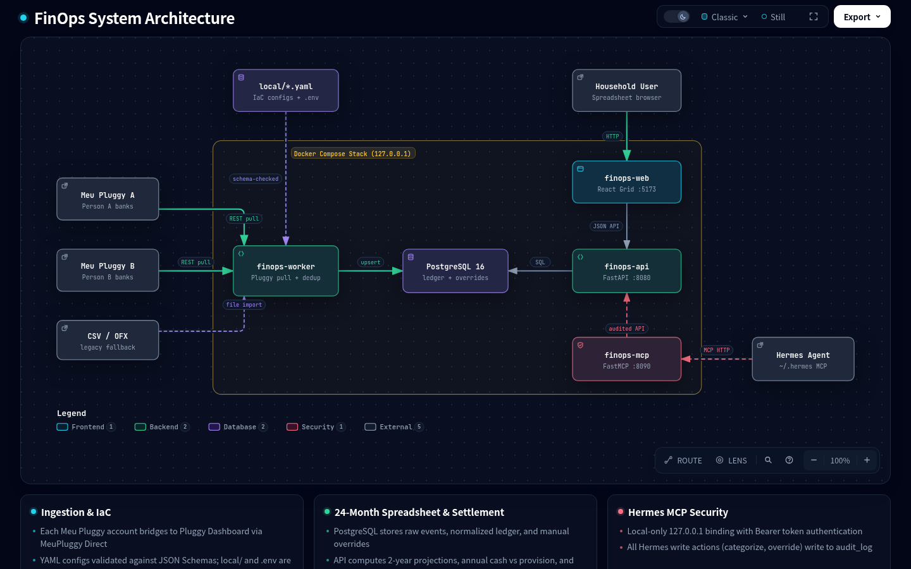
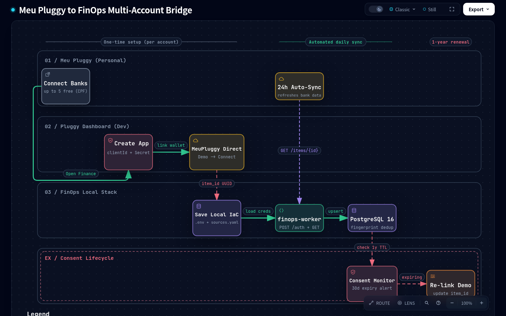

# FinOps

An open-source, Infrastructure-as-Code (IaC) household financial planning platform that consolidates **multiple Meu Pluggy Open Finance accounts** into **PostgreSQL**, provides a **24-month spreadsheet UI** (current calendar year + next calendar year) with expense projections and automatic shared-expense settlement, and integrates natively with **Hermes Agent** via **MCP (Model Context Protocol)**.

> **Privacy & Open-Source First:** Zero personal data (PII) and zero secrets are committed to this repository. All household YAML configurations live in `local/` (gitignored) or an external private config directory mounted via `FINOPS_CONFIG_DIR`.

---

## Core Capabilities

- **Multi-Account Open Finance Ingestion (`v2` + Investments):** Consolidates 2+ personal **Meu Pluggy** accounts via Pluggy's official Personal Use bridge (`meu.pluggy.ai` -> `dashboard.pluggy.ai` using the `MeuPluggy` Direct connector), pulling checking accounts (`reservedBalances` included), credit cards, cursor-paginated `GET /v2/transactions`, and active `GET /investments` (CDB/RDB/Caixinhas, funds, treasury), with optional CSV/OFX fallback.
- **Total Saved & Net Liquidity Tracking:** Displays consolidated household savings (**Checking + Investments/CDBs**), open credit-card balances, net post-card liquidity, per-person savings breakdown, and starting balance for 24-month cash-flow projections.
- **Declarative YAML Configuration (IaC):** People, cost-sharing weights, data sources (`item_id` UUIDs), 2-level categories/subcategories, auto-categorization rules (`match_regex`, Open Finance `match_provider_category`, and `match_amount_sign`), internal-transfer rules, recurring items, and annual expenses are versionable YAML validated against JSON Schemas.
- **24-Month Spreadsheet UI (Current Year + Next Year):**
  - Hierarchical rows across **General (Shared)**, **Per-Person**, **Subcategories** (e.g., Groceries, Dining Out), and **Annual/Seasonal** items (e.g., IPVA, IPTU, insurance, vacations).
  - Instant toggle between **Cash View** (full annual payment in its due month) and **Monthly Provision View** (`amount / 12` monthly reserve).
  - Layered projections: manual cell overrides -> posted/detected future credit-card installments -> YAML recurring/annual rules -> rolling moving averages or budget caps, with a transparent **How This Cell Was Calculated** breakdown drawer.
- **Automatic Shared-Expense Settlement:** Tracks who paid each `shared` expense and calculates the exact monthly settlement transfer between household members based on configurable split weights.
- **Hermes Agent Integration (`finops-mcp`):** Exposes typed, audited MCP tools (read, what-if simulation, transaction categorization, projection overrides, and sync health checks) plus a dedicated Hermes Skill.

---

## System Architecture

<picture>
  <source media="(prefers-color-scheme: dark)" srcset="docs/diagrams/system-architecture.dark.png">
  <source media="(prefers-color-scheme: light)" srcset="docs/diagrams/system-architecture.light.png">
  
</picture>

*Generated with [Archify](https://github.com/tt-a1i/archify) — open the interactive diagram: [docs/diagrams/system-architecture.html](docs/diagrams/system-architecture.html) ([source JSON](docs/diagrams/system-architecture.json)).*

For architectural decision records (ADRs) and internal details, see [docs/architecture.md](docs/architecture.md).

---

## How Multi-Account Pluggy Works (`meu.pluggy.ai` vs. `dashboard.pluggy.ai`)

FinOps is designed to consolidate **2+ household members' Open Finance accounts** (e.g., Person A and Person B) without scraping and without a paid commercial Pluggy plan. Understanding the two Pluggy portals is essential:

| Platform | Purpose | Role in FinOps |
| :--- | :--- | :--- |
| **[meu.pluggy.ai](https://meu.pluggy.ai)** *(Meu Pluggy — Data Passport)* | Personal Open Finance wallet for individuals | Each person connects up to **5 banks for free** (personal use, no trial expiration) and manages LGPD consents. Refreshes bank data automatically every **24 hours**. Does **not** issue standalone API keys or export CSV/OFX. |
| **[dashboard.pluggy.ai](https://dashboard.pluggy.ai)** *(Pluggy Developer Dashboard)* | Developer API portal | Each person signs in with the **same email** used in Meu Pluggy, creates an Application (`clientId` + `clientSecret`), and mirrors their Meu Pluggy wallet via the **`MeuPluggy` Direct** connector so FinOps can pull accounts & transactions over `https://api.pluggy.ai`. |

### Why Each Household Member Has an Independent Credential Pair
Because Pluggy Dashboard only mirrors the Meu Pluggy wallet belonging to the **same account/email**, a 2-person household uses **two independent credential pairs** in `.env`:
- `PLUGGY_PERSON_A_CLIENT_ID` / `PLUGGY_PERSON_A_CLIENT_SECRET` -> mapped to `person_a` in `local/sources.yaml`
- `PLUGGY_PERSON_B_CLIENT_ID` / `PLUGGY_PERSON_B_CLIENT_SECRET` -> mapped to `person_b` in `local/sources.yaml`

FinOps (`finops-worker`) authenticates both profiles independently, pulls each declared `item_id` into a single PostgreSQL ledger, automatically marks inter-account transfers and credit-card bill payments as `internal_transfer` (avoiding double counting), and attributes every transaction to the right person or to `shared` (General).

<picture>
  <source media="(prefers-color-scheme: dark)" srcset="docs/diagrams/pluggy-bridge-workflow.dark.png">
  <source media="(prefers-color-scheme: light)" srcset="docs/diagrams/pluggy-bridge-workflow.light.png">
  
</picture>

*Generated with [Archify](https://github.com/tt-a1i/archify) — open the interactive diagram: [docs/diagrams/pluggy-bridge-workflow.html](docs/diagrams/pluggy-bridge-workflow.html) ([source JSON](docs/diagrams/pluggy-bridge-workflow.json)).*

---

## Step-by-Step Pluggy Setup

Repeat **Steps 1–4** once for **Account 1 (Person A)** and once for **Account 2 (Person B)**:

1. **Connect your banks in Meu Pluggy:**
   - Sign in at [https://meu.pluggy.ai](https://meu.pluggy.ai) and authorize your banks/credit cards via Open Finance (up to 5 free connections per account).
2. **Create a Pluggy Dashboard Application:**
   - Sign in at [https://dashboard.pluggy.ai](https://dashboard.pluggy.ai) using the **exact same account/email** used in Meu Pluggy.
   - Open **Applications** -> create a new app (e.g., `finops-personal`).
   - Copy the **Client ID** and generate/copy the **Client Secret** (shown only once).
3. **Mirror your Meu Pluggy wallet via the `MeuPluggy` Direct connector:**
   - In your Dashboard app, open **Demo -> Connect Account**.
   - Select the **`MeuPluggy` (Direct, Connector ID `200`)** connector *(do **not** pick the individual bank connector and do **not** use Sandbox)*.
   - Sign in with your Meu Pluggy account. A single mirrored **`MeuPluggy` Item** appears under **Demo -> Connected Items**, aggregating all accounts, credit cards, and investments connected inside that Meu Pluggy wallet without repeating CPF/bank authorization.
4. **Find and copy the `MeuPluggy` `item_id` UUID:**
   - Because `GET /v2/items` returns `403 Forbidden` on Meu Pluggy personal accounts, each person's `MeuPluggy` `item_id` must be listed explicitly in `local/sources.yaml` (typically just **1 UUID per household member**).
   - You can grab the UUID from either place in the app's **Demo** tab:
     - **Directly from the browser URL:** `https://dashboard.pluggy.ai/applications/<APPLICATION_ID>/demo?itemId=<ITEM_ID>`
     - **From the Item JSON preview button** in the Demo dashboard (look for the top-level `"id"` field where `"connector.id": 200` and `"connector.name": "MeuPluggy"`).
   - Initialize local gitignored files:
     ```bash
     ./scripts/init_local.sh
     ```
   - Put your `Client ID` and `Client Secret` in `.env` (`PLUGGY_PERSON_A_*` and `PLUGGY_PERSON_B_*`).
   - Put the copied `item_id` UUIDs in `local/sources.yaml` and set `default_scope` (`personal` or `shared`) per item.
5. **Validate configuration and verify live API connectivity:**
   ```bash
   uv run python scripts/validate_config.py --config-dir local
   uv run python scripts/verify_pluggy.py --config-dir local
   ```

> **Operational Notes:**
> - **24-hour refresh (webhooks optional):** Meu Pluggy refreshes bank data automatically every 24 hours; Dashboard mirrored items cannot trigger manual bank refreshes. For local `127.0.0.1` deployments, scheduled polling is recommended (no public HTTPS port needed). Webhooks are optional—if enabled via a tunnel/VPS, FinOps verifies signatures using `PLUGGY_PERSON_*_CLIENT_WEBHOOK_SIGN_SECRET`.
> - **1-year authorization TTL:** The Meu Pluggy -> Dashboard bridge expires after 1 year (`consentExpiresAt`). FinOps (`verify_pluggy.py`, UI, and Hermes alerts) warns you 30 days ahead. When renewed in Dashboard Demo, `item_id` may change—FinOps uses content-fingerprint deduplication so updating `local/sources.yaml` never duplicates history.

See [docs/meu-pluggy-setup.md](docs/meu-pluggy-setup.md) for troubleshooting and renewal details.

---

## Quickstart (Full Containerized Stack)

### Prerequisites
- [Docker](https://docs.docker.com/get-docker/) & Docker Compose v2+
- [uv](https://docs.astral.sh/uv/) (Python 3.12+ dependency & script runner)
- [Node.js 22+](https://nodejs.org/) (optional for local web dev & Archify diagram rendering)

```bash
# 1. Initialize gitignored .env and local/*.yaml templates
./scripts/init_local.sh

# 2. Validate YAML configurations against JSON Schemas
uv run python scripts/validate_config.py --config-dir local

# 3. Build and start the complete 5-service stack (bound to 127.0.0.1)
docker compose up -d --build
```

Once healthy, open:
- **Spreadsheet UI:** `http://localhost:5173`
- **REST API & OpenAPI Docs:** `http://localhost:8080/docs`
- **Hermes MCP Endpoint:** `http://localhost:8090/mcp`

> **Want to explore immediately without connecting a bank?**
> Click **Demo Seed** in the top-right corner of the UI (or run `docker compose exec api python -m finops.worker.main --seed-demo`) to load 6 months of synthetic 2-person transactions, active credit-card installments, annual items, and shared-expense settlement.

### Local Tests, Linting & Backups
```bash
uv run ruff check .
uv run pytest
./scripts/backup_db.sh   # writes gzipped pg_dump into gitignored backups/
```

---

## Documentation

- [Architecture & Design Decisions](docs/architecture.md)
- [Meu Pluggy -> Pluggy Dashboard Setup Guide](docs/meu-pluggy-setup.md)
- [Hermes Agent MCP Integration Guide](docs/hermes-integration.md)
- [Contributing Guidelines](CONTRIBUTING.md)
- [Security Policy](SECURITY.md)

---

## Project Roadmap

- [x] **Phase 0:** Open-source repository foundation, JSON Schemas, YAML validator, CI + Gitleaks, Archify architecture/workflow diagrams, Docker Compose PostgreSQL base, and Pluggy connectivity verifier.
- [x] **Phase 1:** PostgreSQL schema + Alembic migrations, multi-account `PluggyApiAdapter`, CSV/OFX fallback adapter, internal transfer detection, and synthetic demo seed.
- [x] **Phase 2:** Auto-categorization engine, credit-card installment projector, 24-month matrix API, and automatic shared-expense settlement engine.
- [x] **Phase 3:** Spreadsheet-first React + TanStack Table UI with inline overrides, cell drill-down, cash vs. monthly provision toggle, CSV/OFX upload, XLSX export, and uncategorized triage.
- [x] **Phase 4:** `finops-mcp` container (Streamable HTTP + Bearer auth + audit log) and versioned Hermes Agent Skill (`integrations/hermes/skills/finops/`).
- [x] **Phase 5:** Automated PostgreSQL backup script (`scripts/backup_db.sh`), XLSX/CSV export, CI web build check, and full documentation.

---

## License

Released under the [MIT License](LICENSE).
