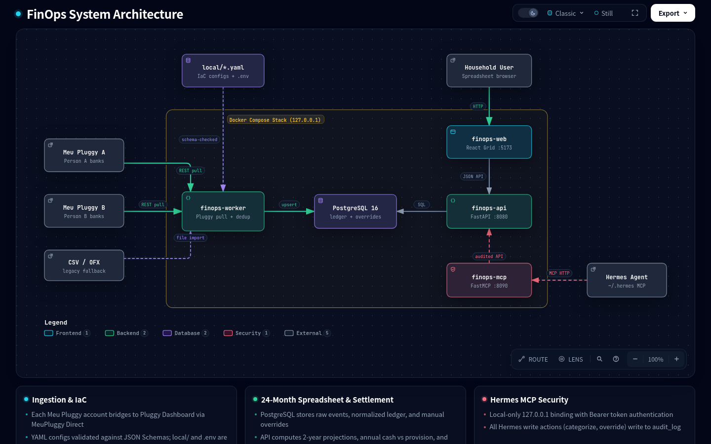

# FinOps Architecture & Design Decisions

## 1. Architectural Principles

1. **Single Source of Truth (PostgreSQL 16):** Raw Open Finance events, normalized transactions, categorization rules, manual projection overrides, and audit logs are stored in PostgreSQL. Both the Spreadsheet UI and Hermes Agent operate exclusively on this normalized layer.
2. **Infrastructure-as-Code (Declarative YAML):** Household members (`people.yaml`), data sources (`sources.yaml`), 2-level taxonomy (`categories.yaml`), categorization/transfer rules (`rules.yaml`), and recurring/annual assumptions (`projections.yaml`) are declared in YAML and validated against JSON Schemas (`config/schemas/`).
3. **Strict Privacy Separation:** Repository templates in `config/examples/` contain only generic placeholders. Real household configs live in `local/` (gitignored) or an external private config repo mounted via `FINOPS_CONFIG_DIR`.
4. **Adapter-Based Ingestion:** Decouples bank ingestion (`PluggyApiAdapter`) from fallback file ingestion (`FileImportAdapter` for CSV/OFX) and synthetic demo seeding.

---

## 2. System Topology

<picture>
  <source media="(prefers-color-scheme: dark)" srcset="diagrams/system-architecture.dark.png">
  <source media="(prefers-color-scheme: light)" srcset="diagrams/system-architecture.light.png">
  
</picture>

*Interactive Archify diagram: [diagrams/system-architecture.html](diagrams/system-architecture.html) ([source JSON](diagrams/system-architecture.json)).*

---

## 3. Key Architectural Decisions (ADRs)

### ADR-001: Multi-Account Pluggy Personal Use Bridge
- `meu.pluggy.ai` (Personal Open Finance wallet) and `dashboard.pluggy.ai` (Developer API portal) are separate platforms. Meu Pluggy does not issue standalone API keys; instead, each user bridges their Meu Pluggy wallet to their Dashboard application using the `MeuPluggy` Direct connector.
- Because `GET /v2/items` returns `403` on Meu Pluggy accounts, `item_id` UUIDs are explicitly declared in `sources.yaml`.
- Because annual consent renewal can generate a new `item_id`, transaction deduplication combines `(source_id, external_id)` with a deterministic `dedup_fingerprint` (normalized institution/account + date + amount + normalized description).

### ADR-002: 24-Month Fixed Calendar Horizon (Current Year + Next Year)
- The default spreadsheet matrix spans **24 consecutive calendar months** (`Jan..Dec` of the current year + `Jan..Dec` of the next year) with summary columns (`Current Year Total`, `Next Year Total`, `Monthly Average`).
- Annual/seasonal expenses (`is_annual: true`) support an instant UI toggle between **Cash View** (full outflow in `due_month`) and **Monthly Provision View** (`amount / 12` per month).

### ADR-003: Layered Projection Precedence
Future cells are computed deterministically using four priority layers:
1. **Manual Override:** Explicit user/Hermes cell edit stored in `projection_overrides` (never overwritten by sync).
2. **Detected Installments:** Real future credit-card installments parsed from transaction metadata/descriptions (`X/Y`).
3. **YAML Rules:** Fixed recurring items and annual items declared in `projections.yaml`.
4. **Statistical / Budget Fallback:** Rolling $N$-month moving average (`moving_avg_3m`, `moving_avg_6m`) or `monthly_budget_cap`.

### ADR-004: Automatic Shared-Expense Settlement Engine
- Every transaction with `scope = shared` tracks `paid_by_person_id` (inferred from the originating account/card).
- Monthly settlement computes each member's target share from `people.yaml` weights (with optional per-category overrides) and derives the exact net transfer needed between household members.
- Settlement transfers between household accounts are classified as `is_internal_transfer = true` so they never inflate household expenses.

### ADR-005: Dedicated `finops-mcp` Server for Hermes Agent
- Pluggy's official hosted MCP (`mcp.pluggy.ai/mcp`) only serves API documentation and developer-portal diagnostics—not personal financial transactions.
- Exposing a dedicated `finops-mcp` service in front of `finops-api` guarantees that Hermes Agent uses the exact same projection, categorization, and settlement logic as the UI, with Bearer token authentication and a full `audit_log` for write operations.
