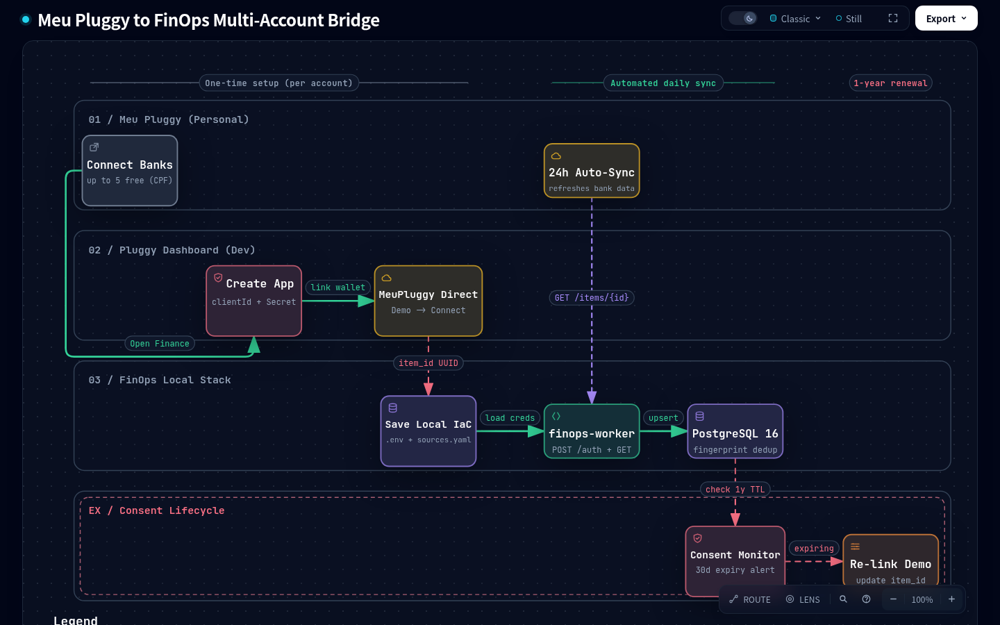

# Meu Pluggy -> Pluggy Dashboard Setup Guide (Personal Use)

This guide explains how to connect **2 personal Open Finance accounts** from `meu.pluggy.ai` to FinOps using Pluggy's free **Personal Use API**—with zero scraping and without paying for a commercial plan.

---

## Understanding the Two Platforms

- **`https://meu.pluggy.ai` (Meu Pluggy — Data Passport):** Your personal Open Finance wallet. Free for personal use (up to **5 bank connections** per account, no commercial trial expiration), with automatic **24-hour background sync**. It does **not** issue standalone API keys or export CSV/OFX files.
- **`https://dashboard.pluggy.ai` (Pluggy Dashboard):** Pluggy's developer portal where you create an Application to obtain `clientId` and `clientSecret` and query `https://api.pluggy.ai`.

To read your personal Meu Pluggy data programmatically, you **mirror** each Meu Pluggy account into a Pluggy Dashboard Application using the **`MeuPluggy` Direct connector**.

<picture>
  <source media="(prefers-color-scheme: dark)" srcset="diagrams/pluggy-bridge-workflow.dark.png">
  <source media="(prefers-color-scheme: light)" srcset="diagrams/pluggy-bridge-workflow.light.png">
  
</picture>

*Interactive Archify diagram: [diagrams/pluggy-bridge-workflow.html](diagrams/pluggy-bridge-workflow.html) ([source JSON](diagrams/pluggy-bridge-workflow.json)).*

---

## Step-by-Step Setup (Repeat for Account 1 and Account 2)

### Step 1 — Connect Banks in Meu Pluggy
1. Sign in to [https://meu.pluggy.ai](https://meu.pluggy.ai).
2. Connect your bank accounts and credit cards via Open Finance (up to 5 institutions per person).
3. Complete the authorization flow in each bank's app.

### Step 2 — Create a Pluggy Dashboard Application
1. Sign in to [https://dashboard.pluggy.ai](https://dashboard.pluggy.ai) using the **same account/email** used in Meu Pluggy.
2. Go to **Applications** and create a new application (e.g., `finops-personal`).
3. Copy the **Client ID** and generate/copy the **Client Secret** (shown only once).
4. Place both values in your local `.env` file (never commit `.env`):
   - Account 1: `PLUGGY_PERSON_A_CLIENT_ID` and `PLUGGY_PERSON_A_CLIENT_SECRET`
   - Account 2: `PLUGGY_PERSON_B_CLIENT_ID` and `PLUGGY_PERSON_B_CLIENT_SECRET`

### Step 3 — Mirror Your Meu Pluggy Wallet via the `MeuPluggy` Connector
1. Inside your application on `dashboard.pluggy.ai`, open **Demo → Connect Account**.
2. Search for and select the **`MeuPluggy` (Direct, Connector ID `200`)** connector.
   - **Important:** Do **not** select the individual bank connector directly and do **not** use Sandbox.
3. Authenticate with your Meu Pluggy account.
4. A single mirrored **`MeuPluggy` Item** will appear under **Demo → Connected Items**, exposing all accounts, credit cards, and investments connected inside that Meu Pluggy wallet without repeating CPF/bank app approval.

### Step 4 — Find and Record the `item_id` in `local/sources.yaml`
Because `GET /v2/items` returns `403 Forbidden` for Meu Pluggy personal accounts, you must explicitly list each person's `MeuPluggy` Item UUID in `local/sources.yaml` (usually just **1 UUID per household member**):

1. Open your connected `MeuPluggy` Item in the app's **Demo** tab. You can copy the UUID from either:
   - **The browser URL query parameter:**
     ```text
     https://dashboard.pluggy.ai/applications/<APPLICATION_ID>/demo?itemId=<ITEM_ID>
     ```
   - **The Item JSON preview button** in the Demo dashboard — copy the top-level `"id"` field (verify `"connector.id": 200` and `"connector.name": "MeuPluggy"`):
     ```json
     {
       "id": "00000000-0000-0000-0000-000000000001",
       "connector": {
         "id": 200,
         "name": "MeuPluggy"
       },
       "status": "UPDATED",
       "executionStatus": "SUCCESS",
       "consentExpiresAt": "2027-01-01T00:00:00.000Z"
     }
     ```
2. Run `./scripts/init_local.sh` if you haven't already.
3. Edit `local/sources.yaml` and replace the placeholder UUIDs under `pluggy_person_a` and `pluggy_person_b`.
4. Set `default_scope` per item (`personal` or `shared` if a specific account is exclusively used for household expenses).

### Step 5 — Validate Config & Verify API Connectivity
```bash
# 1. Validate YAML syntax, schemas, and cross-references
uv run python scripts/validate_config.py --config-dir local

# 2. Verify live Pluggy API authentication, item health, and consent expiry
uv run python scripts/verify_pluggy.py --config-dir local
```

---

## Operational Caveats to Keep in Mind

- **24-Hour Automatic Sync (Polling vs. Webhooks):** Meu Pluggy refreshes your banks automatically every 24 hours. Mirrored items in Dashboard cannot trigger manual bank refreshes (`nextAutoSyncAt` is `null`), so FinOps periodically pulls the latest synced data from Pluggy into PostgreSQL.
  - **Webhooks are optional (not required for local setups):** Receiving Pluggy webhooks requires exposing a public HTTPS endpoint (e.g., via Cloudflare Tunnel, Tailscale Funnel, or a VPS). Keeping FinOps bound to `127.0.0.1` with scheduled polling (plus on-demand sync via UI/Hermes) is simpler and minimizes attack surface.
  - If you later opt into webhooks, populate `PLUGGY_PERSON_A_CLIENT_WEBHOOK_SIGN_SECRET` / `PLUGGY_PERSON_B_CLIENT_WEBHOOK_SIGN_SECRET` in `.env` so FinOps verifies every webhook signature before processing events.
- **1-Year Authorization Expiry (`consentExpiresAt`):** The authorization between Dashboard Demo and Meu Pluggy lasts **1 year**. When it expires, API endpoints return empty results and the item status transitions to `LOGIN_ERROR` / `USER_AUTHORIZATION_EXPIRED`.
  - FinOps (`verify_pluggy.py`, the Web UI, and Hermes alerts) monitors `consentExpiresAt` and warns you 30 days in advance.
  - To renew, repeat **Step 3** in Dashboard Demo and update `local/sources.yaml` if Pluggy issues a new `item_id`. FinOps deduplicates transactions by content fingerprint so renewing an `item_id` will not duplicate history.
